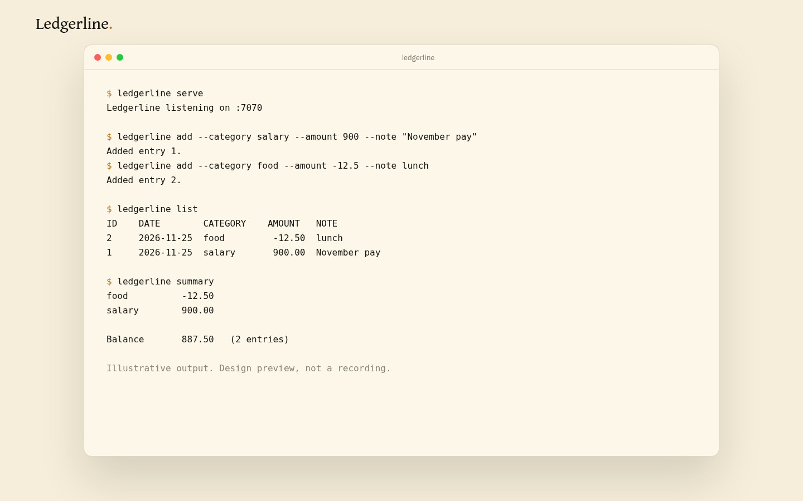
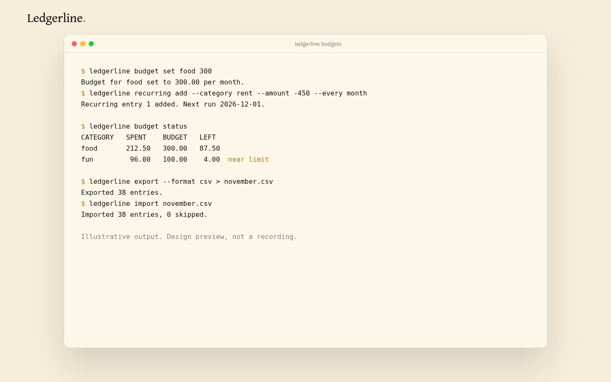

# Ledgerline: personal ledger in Dart

A command-line ledger written in **Dart** with its **own small HTTP service** (shelf, JSON-file storage). It is standalone: no other service or repo is needed.

**Tech:** Dart, command-line tool, args (CommandRunner with sub-commands), shelf, shelf_router, REST API design, API-key auth, JSON-file storage, CSV import and export, budgets, recurring rules, unit tests, `dart compile exe` for a single native binary.

## Usage
```bash
dart pub get
dart run bin/ledgerline.dart serve                       # terminal 1: service on :7070, creates due recurring entries on start

# entries
dart run bin/ledgerline.dart add --category salary --amount 900 --note "November pay"
dart run bin/ledgerline.dart add --category food --amount -12.5 --note lunch --date 2026-11-02 --tag social
dart run bin/ledgerline.dart edit 2 --amount -14
dart run bin/ledgerline.dart delete 2
dart run bin/ledgerline.dart list --category food --from 2026-11-01 --type expense --search lunch
dart run bin/ledgerline.dart summary --from 2026-11-01

# budgets
dart run bin/ledgerline.dart budget set food 300
dart run bin/ledgerline.dart budget list --month 2026-11

# recurring rules
dart run bin/ledgerline.dart recurring add --category rent --amount -500 --every monthly --start 2026-09-01
dart run bin/ledgerline.dart recurring run
dart run bin/ledgerline.dart recurring list

# import, export, reports
dart run bin/ledgerline.dart import bank.csv --dry-run
dart run bin/ledgerline.dart import bank.csv
dart run bin/ledgerline.dart list --format csv --out ledger.csv
dart run bin/ledgerline.dart report --month 2026-11
dart run bin/ledgerline.dart categories

dart test
dart compile exe bin/ledgerline.dart -o ledgerline
```
Config: `--url` or `LEDGERLINE_URL`, and `LEDGERLINE_KEY` (default `dev-key`, change it for anything real).

## CSV format
Required columns `date` (YYYY-MM-DD), `category`, `amount` (negative = expense). Optional `note` and `tags` (separated by `;`). Columns can be in any order. Bad rows are listed with their line number and never block the good ones. Rows that match an existing entry on date, category, amount and note are skipped.

## Service endpoints
All except `/health` need the header `x-api-key`.

| Path | Notes |
|---|---|
| `GET /entries` | `category`, `from`, `to`, `q`, `tag`, `type`, `min`, `max`, `limit`, `offset`; total in `x-total-count` |
| `POST /entries`, `PATCH`, `DELETE /entries/<id>` | validated; dates must be real |
| `GET /entries/export.csv` | same filters |
| `POST /entries/import` | raw CSV body, `?dry_run=1` to check only |
| `GET /summary` | income, expenses, balance, by category (accepts the entry filters) |
| `GET /reports/monthly`, `/reports/breakdown?month=` | totals by month, spending shares by category |
| `GET /budgets?month=`, `PUT, DELETE /budgets/<category>` | status per month |
| `GET, POST /recurring`, `DELETE /recurring/<id>`, `POST /recurring/run` | rules and catch-up |
| `GET /categories` | categories in use |

## Layout
```
bin/ledgerline.dart     CLI with sub-commands
lib/models/             Entry, Budget, Recurring, EntryFilter
lib/csv.dart            CSV parser and importer
lib/dates.dart          date helpers (month clamping)
lib/report.dart         totals, breakdowns, monthly text report
lib/store.dart          JSON-file storage
lib/server.dart         HTTP service
lib/client.dart         HTTP client used by the CLI
test/                   dates, csv, budgets, recurring, store, service
```

## Honest status
Written without running it. Run `dart analyze` and `dart test` first. Money is stored as doubles, which is fine for a small personal tool. A real finance app should use integer cents.

## Screens (design mockups, not recordings)


